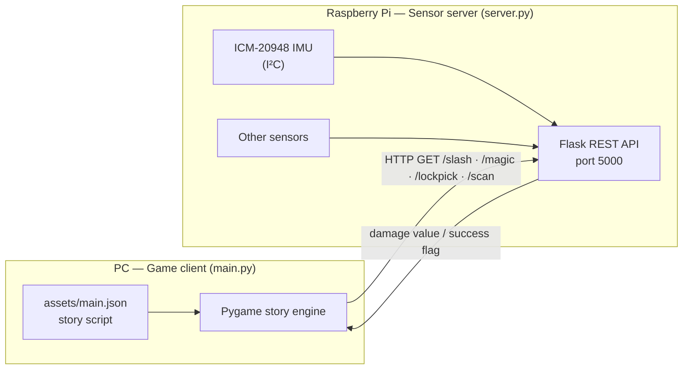

# Motion-Controlled Interactive Story Game (Raspberry Pi + Pygame)


A branching, visual-novel-style adventure game in which key moments are performed **physically**. Swing a motion controller to attack in battle, and complete lock-picking and scanning challenges with sensors connected to a Raspberry Pi.

The game runs on a PC with Pygame; the Raspberry Pi reads the sensors and serves the results to the game over HTTP on the local network.

Final project for an Embedded Systems course.

<!-- TODO: add a photo of the hardware setup and a gameplay screenshot/GIF -->
<!-- TODO: team members and your role, e.g. "Team of N — I built the game engine and the IMU driver" -->

---

## System Architecture



---

## Features

### Data-driven story engine

The entire story lives in `assets/main.json`. Each scene node can specify a background, left/right character sprites and positions, a speaker and line of dialogue, a voice clip, and either the next node or a set of branching choices. Adding content requires no code changes.

- Typewriter-style text rendering with click-to-skip
- Voiced dialogue lines
- Branching choices with hover highlighting
- Image caching for backgrounds and character sprites

### Physical interactions

| Event | How it works |
| --- | --- |
| **Battle — Attack** | The player physically swings the controller. The Pi reads the ICM-20948 accelerometer and returns the acceleration magnitude, which becomes the attack damage. |
| **Battle — Magic** | Damage value returned by the Pi's `/magic` endpoint. <!-- TODO: describe the input --> |
| **Lock picking** | The player has 5 attempts; each attempt queries the Pi, which reports success or failure. <!-- TODO: describe the sensor --> |
| **Scanning** | The player places a hand on a sensor; the game asks them to move closer until the scan succeeds. <!-- TODO: describe the sensor --> |

Battles are turn-based: enemy HP and damage come from the story script, and victory or defeat branches the story to different nodes.

### IMU driver

`imu.py` is an I²C driver for the ICM-20948 9-axis IMU (accelerometer, gyroscope and AK09916 magnetometer) using `smbus2`. It configures the accelerometer at 125 Hz / ±16 g and the gyroscope at 100 Hz / ±250 dps with digital low-pass filtering, and adds a `slash_power()` method that converts the acceleration vector magnitude into m/s².
<!-- TODO: if this driver is based on an existing library (e.g. Pimoroni's icm20948-python), credit it here -->

---

## REST API (Raspberry Pi)

| Endpoint | Returns | Used for |
| --- | --- | --- |
| `GET /slash` | Float (attack damage) | Battle — Attack |
| `GET /magic` | Float (magic damage) | Battle — Magic |
| `GET /lockpick` | `1` on success | Lock picking |
| `GET /scan` | `1` on success | Scanning |

---

## Getting Started

### 1. Raspberry Pi (sensor server)

Enable I²C on the Pi and connect the ICM-20948 to the I²C bus (address `0x68`).

```bash
pip install flask smbus2
python server.py        # listens on 0.0.0.0:5000
```

### 2. PC (game client)

```bash
pip install pygame requests
```

Set `PI_IP` at the top of `main.py` to your Raspberry Pi's IP address, then run:

```bash
python main.py
```

> The UI text is in Traditional Chinese and uses the *Microsoft JhengHei* font by default. On Linux or macOS, run `python check.py` to list installed CJK fonts and update the font in `main.py`.

---

## Project Structure

```
Embedded-Final/
├── main.py      # Pygame game client: story engine, battles, mini-games
├── server.py    # Flask server on the Raspberry Pi
├── imu.py       # ICM-20948 I²C driver + slash-power calculation
├── check.py     # Utility: lists installed CJK fonts
└── assets/
    ├── main.json    # Story script
    ├── bg/          # Background images
    ├── characters/  # Character sprites
    └── sfx/         # Voice lines and sound effects
```

## Tech Stack

- **Game client:** Python, Pygame, Requests
- **Embedded server:** Python, Flask, smbus2 (I²C)
- **Hardware:** Raspberry Pi, ICM-20948 9-axis IMU

---

## Author

**Ricky Chou** · [@RickyChou030](https://github.com/RickyChou030)
